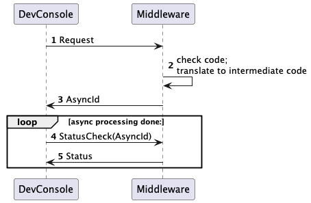
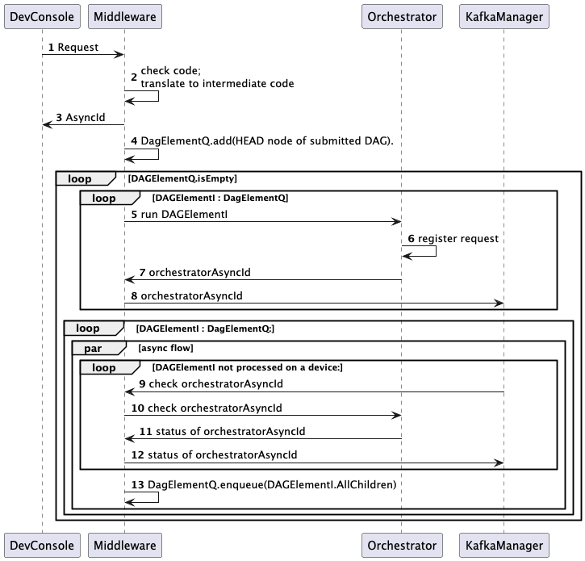
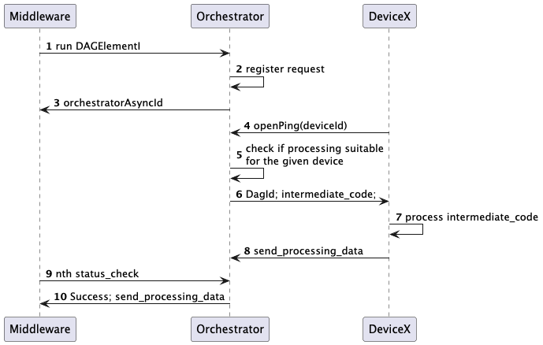
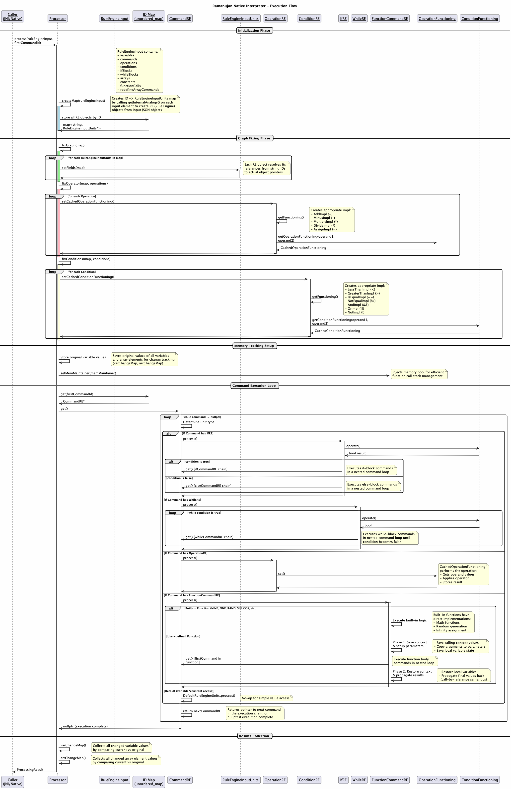

# Code-Flow:

[← Back to main README](../README.md)


The code is submitted to DevConsole process which would be present in the path: `developer-console/target/developer-console-1.0-SNAPSHOT-fat.jar`.
The process would submit the code to the Middleware server, which would be responsible for converting the submitted code
to the intermediate code. The Middleware server would then work with the orchestrator server to process the required DAG.
Once the code gets converted to the intermediate code, the Middleware server would return back an asyncId which the
DevConsole would use to get the result of the code execution.



The Middleware server after creating the intermediate code, would start submitting the DAG-nodes to the orchestrator server.
Whenever a DAG-node gets processed, the Middleware server would submit children - DAG elements to the orchestrator server.
Once, the whole DAG is computed, the Middleware server sets the status of the whole processing as SUCCESS.

Pseudocode of the DAG computation is as follows:
```
DagElementQueue = new Queue();
DagElementQueue.add(rootDagElement);
isDone = false;
while(!isDone) {
   asyncTasks = []
   children = []
   while(DagElementQueue is not empty) {
       DagElement currentElement = DagElementQueue.poll();
       if(currentElement is not processed) {
           asyncTask = asyncCode(currentElement.process(), callback={
              if(currentElement has children) {
                  for(DagElement child : currentElement.children) {
                      children.add(child);
                  }
              }
           })
           asyncTasks.add(asyncTask);
       }
   }
    for(asyncTask : asyncTasks) {
         asyncTask.wait();
    }
    if(children is empty) {
        isDone = true;
    } else {
        for(DagElement child : children) {
            DagElementQueue.add(child);
        }
    }
}
```



Middleware end of the orchestrator:<br>
The Middleware server would submit a computation task to the Orchestrator server. The Orchestrator server would instantly
return back an asyncId that the Middleware server would use to get the result of the computation. The Orchestrator server
would then check for an available device, and will assign the computation task to the device.

Device end of the orchestrator:<br>
Any device-client that is available on the Ramanujan platform, would keep pinging to the Orchestrator server. Currently,
the pings contains the deviceId, but in future it would send in the device-stats as well. The Orchestrator server would
keep track of the devices that are available on the network. On the ping API request, the Orchestrator server would return
back a suitable computation task mapped to the device. The device would then execute the task and return back the result to the
Orchestrator server.

## DAG Result Storage

Result transport and persistence are separate from computation. The orchestrator
and middleware access an object-storage backend through their respective
`StorageDao` abstractions. Workers receive upload instructions, not storage
credentials or middleware-specific serialization classes.

### Worker Upload and Task Completion

For a backend that supports signed uploads, the result flow is:

1. The orchestrator assigns a DAG vertex's execution task to a worker.
   `StorageDao.createResultUploadTarget(taskId, hostId)` adds a `resultUpload`
   target to the assignment: `uploadUrl`, `objectName`, `expiresAt` (epoch
   milliseconds), and required `headers`. The signed PUT URL is valid for
   **24 hours** and is scoped to one task, worker, and upload attempt.
2. The worker serializes the native result as `HostResult` JSON,
   `{"map": <native result>}`, and uploads it directly to object storage.
   It must send the supplied headers and the exact content type
   `application/json`. The upload is create-only: it cannot overwrite an
   existing object.
3. After uploading, the worker calls `/task/complete` with `uuid`, `hostId`,
   `resultObject`, `resultSize` (bytes), and `resultMd5` (base64-encoded MD5).
   This request contains a reference rather than the result payload; inline
   `data` and an uploaded reference are mutually exclusive.
4. The orchestrator checks that the task is processing and still belongs to
   this worker. `StorageDao.acceptResultUpload` validates the task/worker/attempt
   reference and verifies the stored object's size, checksum, and content type.
   A server-side copy promotes the verified object to the canonical task result
   location, without downloading and retransmitting its body through the server.
5. Only after result persistence succeeds does the orchestrator update its task
   status to `SUCCESS` and release the worker assignment. Middleware processing
   and the overall DAG's completion happen separately.

The worker continues heartbeats during computation, upload, and completion
retries. A timed-out PUT may have stored the object already; the server still
verifies it before acceptance. Promotion is create-only and idempotent for the
same upload; a conflicting upload cannot replace the accepted result. If the
status update fails after promotion, completion can retry against the existing
canonical object. Once a task is successful, completion retries do not require
the staging object to remain available.

Storage or signing errors propagate rather than silently switching protocols.
Malformed references and task/assignment conflicts are permanent errors;
transient transport failures are retried. Backends without signed-upload support,
including local storage, return no upload target, and workers use the existing
inline `/task/complete` protocol. Older workers can also submit inline results.
Deploy compatible server changes before workers during rollout.

Direct uploads avoid routing large result bodies through the orchestrator's
HTTP endpoint and its request-size limits. They do not remove worker/server
memory limits, result-query response limits, or the requirement to serialize
portable data: native `binaryArrayFiles` paths are not uploaded by this protocol
and cannot be used as cross-machine result references.

### Object Layout and Middleware Persistence

The middleware async ID identifies the entire computation; the orchestrator task
ID identifies one execution task. Neither should be confused with the DAG vertex
ID or worker host ID.

| Purpose | Storage namespace | Object key | Content |
|---------|-------------------|------------|---------|
| Staged worker upload | `dag_element_result` | `uploads/<taskId>/<hostId>/<attemptId>` | Native `HostResult` JSON |
| Accepted task result | `dag_element_result` | `<taskId>` | Verified `HostResult` JSON |
| Middleware vertex output | `dag-element-array-values` | `<asyncId>/dag_vertices/<dagElementId>` | `DagVertexOutput` |
| Compacted child input | `dag-element-array-values` | `<asyncId>/compacted/<childDagElementId>` | `CompactedDagInput` |

Middleware reads the accepted task result from shared storage and converts it
into `DagVertexOutput`, containing `asyncId`, `dagElementId`, `variableMap`, and
`arrayMap`. It stores this vertex output and also writes scalar variables and
array values to the relational database. Array value identity is
`(asyncId, arrayId, indexStr)`, not the optional display name.

These storage and database writes are not one atomic transaction. A durable
object or successful orchestrator task does **not** establish that middleware
persistence or the whole DAG succeeded. Middleware must finish the required
writes and dependency processing before marking the overall task `SUCCESS`.
Queue-driven polling uses shared task state and result storage, so middleware
queue consumption and database persistence do not require machine affinity.

The HTTP service initializes its database and storage clients on a worker thread.
Queue consumption starts only after that initialization and HTTP deployment
succeed; startup failures propagate to the main verticle instead of allowing
messages to access partially initialized clients.

Within one middleware process, overlapping events for the same async ID and DAG
vertex are rejected for queue retry while the first event remains active. Result
preparation, query construction, and output serialization run off event loops.
Array values are persisted in sequential batches of at most 1,000 rows, with one
array write active per vertex. Scalars and the vertex object are written only
after the preceding database writes finish. A failure stops subsequent writes
and propagates only after the active write has settled, so a retry cannot overlap
unfinished writes from that attempt. This is not a cross-process lock or an
atomic transaction; partial writes remain safe to repeat through array upserts.

### Parent Compaction and Retention

Before submitting a dependent vertex, `DagElementCompactionService` reads its
parents' stored `DagVertexOutput` objects. It coalesces scalar values and sparse
array-index maps into `CompactedDagInput` and stores that input under the child's
key. Arrays are merged by array ID with indices ordered by `IndexComparator`.
The current disjoint-write contract keeps the first encountered value for an
overlapping array index; scalar keys use the last encountered parent's value.
Compaction combines state, rather than summing values or rerunning parents.

Signed URLs are bearer credentials: do not log or expose them. The signing
identity needs permission to sign upload URLs and access the result objects;
workers need only the scoped URL and headers, not backend credentials.

URL expiry ends upload authorization but does not delete objects. Configure a
staging lifecycle rule restricted to the `uploads/` prefix, with retention longer
than the upload/retry window (for example, two days). Do not apply that staging
rule to accepted task results. On overall DAG success, middleware
`cleanupAsyncId` deletes vertex outputs and compacted inputs under `<asyncId>/`
in `dag-element-array-values`; cleanup failures are logged as warnings. This
cleanup does not delete staged uploads or canonical orchestrator results, whose
retention is managed separately.


#### Use of Kafka-Manager:
This service helps the system to resume in case the Middleware server goes down. This server becomes a part of a PubSub system.
It can be part of Apache-Kafka, GCP-PubSub, and a local PubSub system. The producers and consumer in the server code can
be extended to use any of the PubSub systems.

In addition to this, the Middleware servers are stateless and do not have the track of the asyncIds. The Kafka-Manager server keeps the track
of the asyncIds. The messages on the PubSub queue contains the asyncId and the status of the computation. The consumer of
the Kafka-Manager server would ping the Middleware server with the asyncId to get the result of the computation. This helps
the Middleware server to move forward with the DAG computation.

## Native Interpreter Flow:

The Ramanujan native interpreter (`ramanujan-native`) is the core execution engine responsible for running the intermediate code on devices. Written in C++ for maximum performance, it provides a sophisticated bytecode-like execution environment that can run on any device with minimal overhead.



### Interpreter Architecture Overview:

The interpreter is designed with a two-phase architecture: first, it converts JSON-based intermediate representation into an optimized in-memory graph of execution objects, then it executes the command chain. This design separates parsing overhead from execution, enabling efficient repeated execution.

---

### Phase 1: Initialization

When the `Processor.process()` method is invoked, it receives:
- **RuleEngineInput**: A structured object parsed from JSON containing all program elements
- **firstCommandId**: The entry point command ID for execution

The `RuleEngineInput` contains vectors of all program constructs:
| Component | Description |
|-----------|-------------|
| `variables` | Scalar variables (integer, double) |
| `arrays` | Multi-dimensional arrays |
| `constants` | Immutable values |
| `commands` | Execution units (each command wraps an operation, condition, function call, etc.) |
| `operations` | Arithmetic and assignment operations (+, -, *, /, =) |
| `conditions` | Comparison and logical operations (<, >, ==, !=, &&, \|\|) |
| `ifBlocks` | Conditional branching structures |
| `whileBlocks` | Loop structures |
| `functionCalls` | Function definitions and call sites |

**ID Map Creation:**
The `createMap()` method iterates through all input elements and calls `getInternalAnalogy()` on each. This factory method converts input objects (parsed from JSON) into Rule Engine (RE) objects optimized for execution:

```
Variable  →  VariableRE
Array     →  ArrayRE  
Command   →  CommandRE
Operation →  OperationRE
Condition →  ConditionRE
If        →  IfRE
While     →  WhileRE
FunctionCall → FunctionCallRE
```

The resulting `unordered_map<string, RuleEngineInputUnits*>` allows O(1) lookup of any program element by its unique ID.

---

### Phase 2: Graph Fixing

After creating the ID map, references between objects must be resolved. During JSON parsing, relationships are stored as string IDs (e.g., a command's `nextId` field contains the ID of the next command). The graph fixing phase converts these string references to actual object pointers.

**`fixGraph(map)`:**
Iterates through all RE objects and calls `setFields(map)` on each. This method:
- Looks up referenced objects by their string IDs
- Stores direct pointers for O(1) access during execution
- Establishes the command chain (linked list of CommandRE objects)

Example for `CommandRE.setFields()`:
```cpp
nextCommandRE = dynamic_cast<CommandRE*>(getFromMap(map, command->nextId));
operationCommand = dynamic_cast<OperationRE*>(getFromMap(map, command->operation));
ifCommandRE = dynamic_cast<IfRE*>(getFromMap(map, command->ifBlocks));
whileCommandRE = dynamic_cast<WhileRE*>(getFromMap(map, command->whileId));
```

**`fixOperator(map, operations)`:**
For each operation, creates a `CachedOperationFunctioning` object. This is a Strategy Pattern implementation where the appropriate operator implementation is selected once and cached:

| Operator | Implementation Class |
|----------|---------------------|
| `+` | `AddImpl` |
| `-` | `MinusImpl` |
| `*` | `MultiplyImpl` |
| `/` | `DivideImpl` |
| `=` | `AssignImpl` |

The cached functor stores direct pointers to operands, eliminating lookup overhead during execution.

**`fixConditions(map, conditions)`:**
Similarly creates `CachedConditionFunctioning` objects for conditions:

| Condition | Implementation Class |
|-----------|---------------------|
| `<` | `LessThanImpl` |
| `>` | `GreaterThanImpl` |
| `<=` | `LessThanEqualToImpl` |
| `>=` | `GreaterThanEqualToImpl` |
| `==` | `IsEqualImpl` |
| `!=` | `NotEqualImpl` |
| `&&` | `AndImpl` |
| `\|\|` | `OrImpl` |

---

### Phase 3: Memory Tracking Setup

Before execution begins, the interpreter saves the original values of all variables and array elements:

```cpp
for(RuleEngineInputUnits* variable : variableREs) {
    VariableRE* variableRE = (VariableRE*)(variable);
    dataFieldOriginalData.insert(make_pair(variableRE->getValPtrPtr(), *variableRE->getValPtrPtr()));
}
```

This enables the `varChangeMap()` and `arrChangeMap()` methods to efficiently compute which values changed during execution—essential for returning results to the calling system.

---

### Phase 4: Command Execution Loop

The main execution loop is elegantly simple:

```cpp
CommandRE* command = dynamic_cast<CommandRE*>(mapBetweenIdAndRuleInput->at(firstCommandId));
while(command != nullptr) {
    command = command->get();
}
```

Each `CommandRE.get()` method:
1. Identifies the type of execution unit it wraps
2. Calls `process()` on that unit
3. Returns the next command pointer (`nextCommandRE`)

**Command Types and Their Execution:**

#### OperationRE (Arithmetic/Assignment)
```cpp
void OperationRE::process() {
    operationFunctioning->set();  // Execute cached operation
}
```
The `CachedOperationFunctioning` directly accesses operand values and stores the result, with no string lookups or type checking at runtime.

#### IfRE (Conditional Branching)
```cpp
void IfRE::process() {
    CommandRE* commandRE;
    if(conditionFunctioning->operate()) {
        commandRE = ifCommandRE;      // Execute if-block
    } else {
        commandRE = elseCommandRE;    // Execute else-block
    }
    while(commandRE != nullptr) {
        commandRE = commandRE->get(); // Nested command loop
    }
}
```
Conditional blocks spawn a nested execution loop for their body commands.

#### WhileRE (Loop Execution)
```cpp
void WhileRE::process() {
    while(conditionFunctioning->operate()) {
        CommandRE* commandRE = whileCommandRE;
        while(commandRE != nullptr) {
            commandRE = commandRE->get(); // Execute loop body
        }
    }
}
```
The outer while loop evaluates the condition; the inner loop executes the body commands.

#### FunctionCommandRE (Function Calls)
Function execution is the most complex operation, involving context management for proper recursion support.

---

### Phase 5: Function Execution (Deep Dive)

The `FunctionCommandRE` handles both user-defined functions and built-in functions.

**Built-in Functions:**
A factory function `GetFunctionCommandRE()` checks the function ID and returns optimized implementations:

| Function | Description |
|----------|-------------|
| `NINF` | Set to negative infinity |
| `PINF` | Set to positive infinity |
| `RAND` | Random number [0, 1) |
| `ABS` | Absolute value |
| `SIN`, `COS`, `TAN` | Trigonometric functions |
| `ASIN`, `ACOS`, `ATAN` | Inverse trigonometric |
| `FLOOR`, `CEIL` | Rounding functions |
| `EXP` | Exponential (e^x) |
| `SQRT` | Square root |
| `POW` | Power function |

Built-in functions have minimal overhead—they directly access argument values and apply the operation.

**User-Defined Function Execution:**

The `FunctionCommandRE.process()` method orchestrates function calls through these steps:

1. **Parameter Setup (Call-by-Reference)**
   - Save current values of function parameters (for restoration after call)
   - Copy argument values from calling context to function parameters
   - This implements pass-by-reference semantics

2. **Local Variable Preservation**
   - Save current values of all local variables in the function
   - Essential for recursive function support

3. **Function Body Execution**
   ```cpp
   command = firstCommand;
   while(command != nullptr) {
       command = command->get();
   }
   ```

4. **Context Restoration & Result Propagation**
   - Restore local variables to pre-call state
   - Propagate final parameter values back to calling context
   - This is how "return values" work—parameters are modified in place

**Memory Management:**
The `DataContainerValueFunctionCommandREMemMaintainer` provides efficient memory pooling for function call contexts, avoiding repeated heap allocations during recursive calls.

---

### Phase 6: Results Collection

After execution completes, two methods collect changed values:

**`varChangeMap()`:**
```cpp
for(RuleEngineInputUnits* variableRE1 : variableREs) {
    VariableRE* variableRE = (VariableRE*)variableRE1;
    double newVal = *variableRE->getValPtrPtr();
    varChangeMap->insert(make_pair(variableRE->id, newVal));
}
```

**`arrChangeMap()`:**
Compares current array values against saved originals and returns only changed elements with their indices.

---

### Data Container Architecture

The interpreter uses a unified data container system:

```
DataContainerValue (abstract)
├── DoublePtr          // Scalar variable value
└── ArrayDataContainerValue
    └── ArrayValue     // Multi-dimensional array storage
        ├── val[]      // Flat double array
        ├── totalSize  // Total element count
        └── dimensions // Shape information
```

This abstraction allows operations and conditions to work uniformly with both variables and array elements.

---

### Performance Optimizations

1. **Cached Functors**: Operations and conditions are pre-compiled into function objects with direct memory access
2. **Memory Pooling**: Function call contexts use pooled memory to avoid allocation overhead
3. **Flat Array Storage**: Multi-dimensional arrays are stored as contiguous memory with computed indexing

---

### Integration Points

The interpreter integrates with the rest of the Ramanujan platform through:

1. **JNI (Java Native Interface)**: For Android and JVM-based clients
2. **Direct C++ API**: For native clients (Linux, macOS, Windows) : Future for non-Java running machines

The `NativeProcessor.cpp` file provides the JNI bridge, receiving JSON input from the Java layer and returning results as structured data.

---
